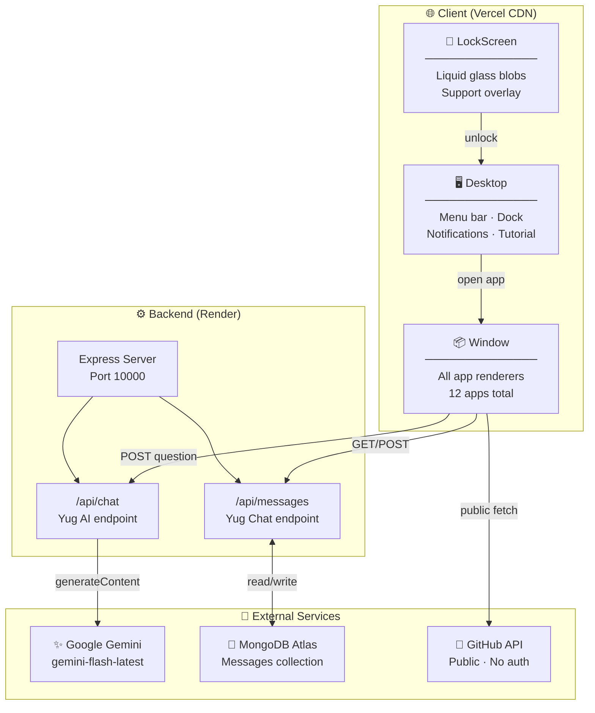
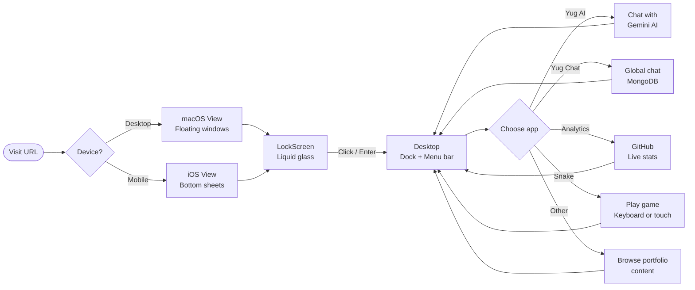

<div align="center">

# 🖥️ Kaalyug OS

**An interactive, macOS-inspired portfolio operating system — built to be explored, not just read.**

[](https://react.dev)
[](https://vite.dev)
[](https://nodejs.org)
[](https://mongodb.com)
[](https://ai.google.dev)
[](https://vercel.com)

> **By [Dirghraj Giri](https://github.com/drj7zz)** — BIT Student | Frontend Developer | Madhesh, Nepal 🇳🇵

</div>

---

## 📸 Two Views — One OS

> Kaalyug OS automatically adapts to your device. It renders as a full **macOS desktop** on larger screens, and as a native **iOS-style home screen** on mobile.

| macOS Desktop View | iOS Mobile View |
|---|---|
| Floating draggable windows | Bottom-sheet slide-up panels |
| macOS menu bar + dock | iOS status bar + frosted dock |
| Traffic-light window controls | Drag handle + swipe to dismiss |
| Spotlight search (⌘K) | Full-screen app grid |

---

## ✨ Features

| App | Description |
|---|---|
| 🤖 **Yug AI** | Gemini-powered AI with full portfolio context — ask anything |
| 💬 **Yug Chat** | MongoDB-backed global chat — all visitors share one room |
| 📊 **GitHub Analytics** | Live stat cards + repo browser from GitHub API |
| 🐍 **Snake** | Canvas game — keyboard on desktop, swipe + d-pad on mobile |
| 🔮 **Liquid Glass Lockscreen** | Animated blobs + frosted glass unlock, lockscreen-only Support |
| 🔔 **Notification Center** | Dismissible cards + browser push permission request |
| 📖 **Tutorial** | 4-step onboarding modal with progress indicators |
| 🌐 **Browser** | Embedded iframe browser with external-open fallback |
| 💻 **Terminal** | Fake shell with portfolio-specific commands |
| 🗂️ **Finder** | Browse and launch all applications |
| ⚙️ **Settings** | Dark / Blue / Pink themes + Kaalyug OS v1.0 info |

---

## 🏗️ Architecture



---

## 🔄 User Flow



---

## 📂 Project Structure

```
giridirghraj/
├── 🌐 frontend/               → Vite + React (→ Vercel)
│   ├── public/
│   │   ├── bg.jpeg            Wallpaper
│   │   ├── drj1.jpg           Profile photo
│   │   └── context.txt        Yug AI system prompt
│   ├── src/components/
│   │   ├── LockScreen.jsx     Liquid glass lockscreen
│   │   ├── Desktop.jsx        Menu, dock, notifications, tutorial
│   │   └── Window.jsx         All 12 app renderers
│   ├── .env.example           → set VITE_API_BASE_URL
│   └── package.json
│
├── ⚙️ backend/                → Express + Node.js (→ Render)
│   ├── server.js              Chat + messages API
│   ├── .env.example           → fill MONGODB_URI + GEMINI_API_KEY
│   └── package.json
│
├── .gitignore                 Blocks all .env files
└── README.md                  You are here!
```

---

## 🚀 Local Development

### Prerequisites
- Node.js 18+
- MongoDB Atlas account (free tier)
- Gemini API key — [get one free →](https://aistudio.google.com/apikey)

### 1. Clone

```bash
git clone https://github.com/drj7zz/giridirghraj.git
cd giridirghraj
```

### 2. Backend

```bash
cd backend
cp .env.example .env          # fill in real values
npm install
node server.js
# → Kaalyug backend listening on http://localhost:10000
```

### 3. Frontend

```bash
cd frontend
cp .env.example .env.local
# Set: VITE_API_BASE_URL=http://localhost:10000/api
npm install
npm run dev
# → http://localhost:5173
```

---

## 🌐 Deployment

### Frontend → Vercel

1. Connect GitHub repo to [vercel.com](https://vercel.com)
2. Root directory: `frontend`
3. Add env variable in Vercel dashboard:

```
VITE_API_BASE_URL = https://YOUR_RENDER_BACKEND.onrender.com/api
```

### Backend → Render

1. New **Web Service** on [render.com](https://render.com)
2. Root directory: `backend`
3. Start command: `node server.js`
4. Environment variables:

| Variable | Value |
|---|---|
| `PORT` | `10000` |
| `MONGODB_URI` | `mongodb+srv://...` |
| `MONGODB_DB` | `kaalyug` |
| `FRONTEND_ORIGIN` | `https://your-project.vercel.app` |
| `GEMINI_API_KEY` | Your Gemini key |

---

## 🔒 Security

- ✅ All secrets in environment variables — never hardcoded
- ✅ `.gitignore` blocks all `*.env*` except `.env.example`
- ✅ CORS restricted to `FRONTEND_ORIGIN` in production
- ✅ JSON body limit: 20kb per request
- ✅ Old credentials invalidated and credentials file deleted
- ✅ No MongoDB driver in frontend bundle

---

## 🛠️ Tech Stack

**Frontend** · React 19, Vite 8, react-rnd, react-markdown, Lucide icons, Vanilla CSS

**Backend** · Node.js, Express, MongoDB Atlas, `@google/generative-ai`

**Hosting** · Vercel (frontend) · Render (backend) · MongoDB Atlas (DB) · Google AI Studio (AI)

---

## 📬 Contact

**Dirghraj Giri** · Madhesh, Nepal

[](mailto:giridirghraj@gmail.com)
[](https://github.com/drj7zz)
[](https://www.instagram.com/drj7zz)

---
