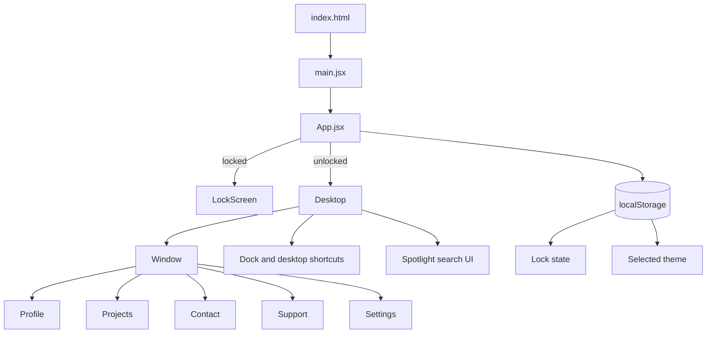
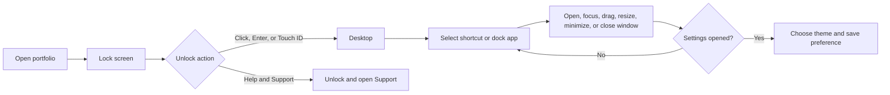

# Kaalyug OS Portfolio

An interactive, desktop-inspired personal portfolio for **Dirghraj Giri**, a frontend developer from Madhesh, Nepal. The experience turns a conventional portfolio into a small operating-system interface: visitors unlock the screen, open apps, move windows, explore projects, and get in touch.

## Highlights

- Desktop-style interface with dock, shortcuts, menu bar, draggable windows, and window controls
- Lock screen with live date/time and a frictionless portfolio unlock flow
- Portfolio apps for profile information, projects, contact, support, and appearance settings
- Dark, blue, and pink themes persisted in the browser with `localStorage`
- Responsive full-screen window experience on mobile devices
- Semantic metadata, Open Graph, Twitter Card, and structured Person data for discoverability

## Technology

| Area | Tools |
| --- | --- |
| UI | React 19, JavaScript, CSS3 |
| Build tooling | Vite 8 |
| Window interaction | `react-rnd` |
| Icons | `lucide-react` |
| Quality checks | Oxlint |

## Architecture



## Visitor flow



## Project structure

```text
frontend/
├── public/                 # Wallpaper, profile image, favicon, and shared assets
├── src/
│   ├── components/
│   │   ├── Desktop.jsx      # Desktop shell, dock, shortcuts, search, window state
│   │   ├── LockScreen.jsx   # Lock/unlock interaction
│   │   └── Window.jsx       # Draggable portfolio application windows
│   ├── App.jsx              # Root state and lock/theme persistence
│   ├── main.jsx             # React entry point
│   └── index.css            # Global styles
├── index.html               # App shell and SEO/social metadata
├── package.json
└── vite.config.js
```

## Getting started

### Prerequisites

- Node.js 20 or newer
- npm 10 or newer

### Installation

```bash
git clone https://github.com/drj7zz/giridirghraj.git
cd giridirghraj/frontend
npm install
npm run dev
```

Vite prints the local development URL in the terminal, usually `http://localhost:5173`.

## Available commands

| Command | Purpose |
| --- | --- |
| `npm run dev` | Start the Vite development server |
| `npm run build` | Create an optimized production build in `dist/` |
| `npm run preview` | Serve the production build locally |
| `npm run lint` | Run Oxlint |

## Customization

- Update portfolio content and external links in `src/components/Window.jsx`.
- Add or change desktop applications in the `apps` collection in `src/components/Desktop.jsx`.
- Replace `public/drj1.jpg` and `public/bg.jpeg` with your profile photograph and wallpaper.
- Adjust color, glass, layout, and responsive styling in the matching CSS files under `src/`.
- Update the metadata in `index.html` before deploying a personalized version.

## Metadata and discoverability

The document head includes a clear page title, description, author and keyword metadata, theme color, Open Graph tags, Twitter Card tags, and Schema.org `Person` structured data. Before a public deployment, set an absolute production URL in the Open Graph image fields if your platform requires it.

## Open source

Kaalyug OS is an open-source portfolio project. You are welcome to study the implementation, fork it, adapt it for your own portfolio, and contribute improvements. Please retain appropriate attribution when reusing substantial parts of the project.

## Contributing

Contributions are welcome.

1. Fork the project.
2. Create a focused branch: `git checkout -b feature/your-feature`.
3. Make and test your changes with `npm run lint` and `npm run build`.
4. Open a pull request that explains the change clearly.

For bugs or feature suggestions, open an issue on the repository or contact the maintainer.

## Contact

- GitHub: [@drj7zz](https://github.com/drj7zz)
- Instagram: [@drj7zz](https://www.instagram.com/drj7zz)
- Email: [giridirghraj@gmail.com](mailto:giridirghraj@gmail.com)

## License

[MIT](LICENSE) © Dirghraj Giri.
